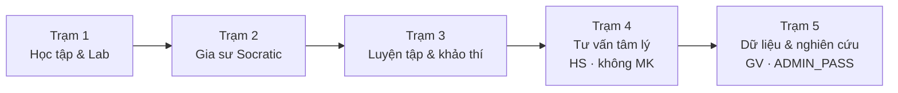

> **Cập nhật 13/11/2026:** README phản ánh mã nguồn trên [`ThayTriCute/CLAUDE_VIPGSAI_KHKT2026`](https://github.com/ThayTriCute/CLAUDE_VIPGSAI_KHKT2026) (đã gộp PR #48). Hệ thống vận hành **5 trạm** (1→2→3→4 tâm lý→5 dữ liệu). Nhật ký kiểm thử cũ: [QA_LIVE_20261024.md](QA_LIVE_20261024.md). Số lượng trong ngân hàng đề là bản ghi/lượt câu, chưa phải số câu độc nhất đã thẩm định. API key và `ADMIN_PASS` chỉ đặt trong Streamlit Secrets — không đưa vào mã nguồn.

# Gia Sư AI (GSAI) — Hệ sinh thái hỗ trợ tự học & cá nhân hóa giáo dục trung học

> **Đề tài KHKT dành cho học sinh trung học năm 2026**  
> Đơn vị: **Trường THPT Tân Hiệp (An Giang)** · Chủ nhiệm: **Thầy Phan Minh Trí**  
> Triết lý: **"Dưỡng thiện tâm – Ươm nhân tài"**  
> Phạm vi: **Lớp 6–12** · **13 môn** theo CT GDPT 2018 · Bộ sách *Kết nối tri thức với cuộc sống*  
> Căn cứ chính: QĐ 764/QĐ-BGDĐT, TT 32/2018, TT 13/2022, TT 22/2021, CV 3175/BGDĐT-GDTrH

---

## Địa chỉ truy cập & mã nguồn

| Hạng mục | Liên kết |
| :--- | :--- |
| **Kho mã nguồn (chính)** | https://github.com/ThayTriCute/CLAUDE_VIPGSAI_KHKT2026 |
| **Web app (Streamlit Cloud / PWA)** | https://claudevipdemogsaikhkt2026.streamlit.app |
| **Tài liệu Drive** | [Thư mục dữ liệu & tài liệu](https://drive.google.com/drive/folders/1ZNIMbaxVSV7NBA3g6MS-Ob7_SbfeWHtv?usp=sharing) |

**File chạy chính:** `app.py`  
**Alias Cloud (cùng nội dung):** `Home.py`, `main.py`, `streamlit_app.py`  
**Deploy Cloud:** [`docs/CLOUD_DEPLOY_CHECKLIST.md`](docs/CLOUD_DEPLOY_CHECKLIST.md) (Secrets `ADMIN_PASS` dạng `sha256:…`, restart sau mỗi lần đẩy mã)
---

## Năm trạm vận hành (thứ tự nút trên UI)

Thứ tự nút: **1 → 2 → 3 → 4 → 5** (không còn nhãn lệch 1-2-3-5-4).



| Trạm | Đối tượng | Nội dung thực tế trong app |
| :---: | :--- | :--- |
| **1** | Học sinh | Tự học theo KNTT/GDPT 2018, infographic, lab/đồ thị, giọng đọc sư phạm |
| **2** | Học sinh | Gia sư Socratic + OCR/camera, gợi mở không giải hộ, bản đồ lỗi / BKT |
| **3** | Học sinh / GV | Luyện tập–khảo thí chuẩn QĐ 764, ngân hàng đề nén XZ, xuất Azota/LaTeX/Word |
| **4** | **Học sinh** | Tư vấn tâm lý học đường; AI khóa triết lý + handbook pháp lý; WHO-5 / check-in giáo dục (phi thương mại); **không cần mật khẩu** |
| **5** | **Giáo viên / chủ dự án** | Nhật ký, hồ sơ cá nhân hóa, kiểm định pre–post, xuất nghiên cứu **ẩn danh**; nạp shard/ngân hàng — **cần `ADMIN_PASS`** |

### Phân quyền nhanh
- **Trạm 4 (tâm lý):** mở cho học sinh tương tác.
- **Trạm 5 (dữ liệu/nghiên cứu):** khóa bằng `ADMIN_PASS` trong `.streamlit/secrets.toml`.
- Excerpt tư vấn thô / CSV nghiên cứu an toàn chỉ phục vụ quản trị khi đã mở khóa Trạm 5.

---

## Hồ sơ cá nhân trên thiết bị (sidebar)

Mỗi người dùng có thể **lưu ngữ cảnh & tiến bộ Trạm 1–5 trên thiết bị**:

- Nén / tải / khôi phục file **`.gsai.xz`**
- Xóa hồ sơ phiên trên thiết bị (không xóa file đã tải về)
- **Không xóa sạch mỗi học kỳ:** cuối HK chỉ nén + **nhìn lại / rút kinh nghiệm / nhận xét / thúc đẩy tự tin / hướng đi**
- Sau ~1 năm: xóa sự kiện thô, **giữ digest** để tiếp nối
- Tối đa **3 năm THPT**: lật lại khoảnh khắc theo năm + hành trình 3 năm; cuối cấp có **lời chào tạm biệt & triết lý hành trang** (*Dưỡng thiện tâm – Ươm nhân tài*)

Module: `services/personal_journey_vault.py`

---

## Trạm 4 — Tư vấn tâm lý học đường (chi tiết)

- Vai trò AI: nhà tâm lý học đường · hành vi sư phạm · triết gia giáo dục (khóa instruction — không bịa luật)
- Neo pháp lý: `data/counseling_legal_references.json` + `services/legal_source_watch.py` / `services/school_counseling.py`
- Chỉ số giáo dục miễn phí: WHO-5 (CC BY-NC-SA) + check-in GSAI — **không phải hồ sơ bệnh án / không chẩn đoán lâm sàng**
- Gói phiên rút gọn (cờ an toàn, không secrets) gửi sang Trạm 5 phục vụ nghiên cứu

Tài liệu khóa AI: [`docs/AI_TRAM5_COUNSELING_LOCK.md`](docs/AI_TRAM5_COUNSELING_LOCK.md) *(tên file lịch sử; chức năng gắn Trạm 4 trên UI)*

---

## Trạm 5 — Dữ liệu & nghiên cứu (chi tiết)

- Nhật ký SQLite / đồng bộ Sheets (nếu cấu hình webhook)
- Hồ sơ cá nhân hóa pre–post, BKT, chủ đề yếu (từ Trạm 2–3)
- Kiểm định thống kê quan sát (paired / hiệu ứng) — không suy nhân quả nếu thiếu đối chứng
- **Xuất nghiên cứu an toàn:** mã `HS-…`, bỏ PII / excerpt tư vấn thô / secrets

---

## Triết lý sư phạm & đạo đức

1. **Dưỡng thiện tâm – Ươm nhân tài** — AI là người thầy đồng hành, không thay thế nhà trường / gia đình / chuyên gia lâm sàng khi vượt thẩm quyền.
2. **Socratic + Polya** — không giải hộ; dẫn dắt hiểu bài → kế hoạch → thực hiện → nhìn lại.
3. **Quyền riêng tư**
   - Hồ sơ đầy đủ ưu tiên **trên thiết bị người dùng**
   - Bản GV–nghiên cứu: ẩn danh / redaction
   - Gemini API / Sheets chỉ khi có cấu hình; cần thông báo luồng dữ liệu cho người dùng

---

## Công nghệ tích hợp (rút gọn theo mã hiện có)

| Thành phần | Vai trò |
| :--- | :--- |
| Streamlit + Gemini (`google-genai`) | UI đa trạm & AI sư phạm |
| BKT / FSRS / psychometrics | Theo dõi tiến bộ & độ tin cậy đề (Trạm 2–3–5) |
| SymPy + LLM | Kiểm chứng biểu thức trong phạm vi hỗ trợ |
| LZMA/XZ shards | Ngân hàng đề & vault cá nhân |
| Plotly / engine đồ họa | Lab & hình học / hàm số |
| SQLite + optional Sheets | Nhật ký bền vững / đồng bộ |

---

## 13 môn · 7 khối (CT GDPT 2018)

| Cấp | Lớp | Môn (tóm tắt) |
| :--- | :--- | :--- |
| THCS | 6–9 | Toán, KHTN, Ngữ văn, Tiếng Anh, Lịch sử & Địa lý, Tin học, GDCD, Công nghệ |
| THPT | 10–12 | Toán, Lý, Hóa, Sinh, Ngữ văn, Tiếng Anh, Lịch sử, Địa lý, Tin học, GDKT-PL, Công nghệ |

Ngữ văn bám CV 3175; Hóa ưu tiên danh pháp IUPAC theo tài liệu hiện hành; Tiếng Anh theo khung NLNN 6 bậc / CEFR.

---

## Chạy local

```bash
git clone https://github.com/ThayTriCute/CLAUDE_VIPGSAI_KHKT2026.git
cd CLAUDE_VIPGSAI_KHKT2026

python -m pip install -r requirements.txt

# Secrets (ví dụ .streamlit/secrets.toml):
# GEMINI_API_KEY = "..."
# ADMIN_PASS = "..."   # hoặc hash — xem scripts/make_admin_pass_hash.py nếu có

streamlit run app.py
# hoặc: streamlit run app.py --server.port 8507
```

Kiểm thử nhanh liên quan trạm mới:

```bash
python -m unittest tests.test_personal_journey_vault tests.test_school_counseling tests.test_tram5_outcome_metrics -v
python scripts/smoke_tram5_counseling.py
```

---

## Cài PWA (biểu tượng màn hình chính)

1. **Android (Chrome / Edge):** menu ⋮ → *Thêm vào Màn hình chính* / *Cài đặt ứng dụng*  
2. **iOS (Safari):** Chia sẻ → *Thêm vào MH chính*  
3. **PC (Chrome / Edge):** biểu tượng cài đặt ứng dụng trên thanh địa chỉ

---

## Cấu trúc thư mục quan trọng

```
app.py / Home.py / main.py / streamlit_app.py
services/          # sư phạm, vault, counseling, scoring, tram4 insights...
data/              # legal refs, exam shards, curriculum
docs/              # khóa AI tư vấn, hướng dẫn nội bộ
tests/             # unittest
scripts/           # smoke / kiểm nguồn pháp lý
textbook_archive_6_12/  # gói neo bài học đã duyệt
.streamlit/        # secrets & config (không commit khóa thật)
```

---

## Thông tin đề tài

- **Tên:** Hệ sinh thái Gia Sư AI hỗ trợ học sinh tự học và cá nhân hóa lộ trình giáo dục trung học theo CT GDPT 2018  
- **Đơn vị:** Trường THPT Tân Hiệp (An Giang)  
- **Chủ nhiệm:** Thầy Phan Minh Trí  
- **Mục tiêu:** Cuộc thi KHKT dành cho học sinh trung học năm 2026  

*Dưỡng thiện tâm – Ươm nhân tài · Mỗi bước tiến của học sinh là niềm hạnh phúc lớn nhất của Người Thầy.*
